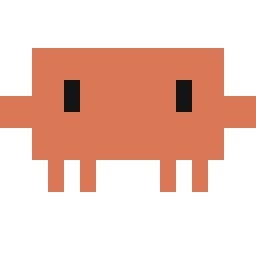

<p align="center"></p>

# Clawd Desktop Pet

A smart, funny desktop pet for Windows starring Clawd, the little orange pixel character from Claude Code.
English + العربية.

> Fan-made project. Not affiliated with or endorsed by Anthropic.

## Download & run
Grab `Clawd.exe` from the [Releases](../../releases) page and double-click it. No install needed.
Settings, notes and the music cache are saved in a `Clawd Data` folder next to the exe, so the whole
thing is portable: copy the folder, share it, done.

## What he does
- **Feels alive**: smooth eased limbs, breathing, blinking, leaning into his steps, curious head tilts,
  yawns, foot-tapping, blushing when petted, a nightcap when he sleeps, headphones when music plays,
  begging for cookies when he's hungry, and waving hello when you come back.
- **Moves around for real**: walks on the taskbar, climbs walls, walks upside-down on the ceiling,
  hangs from a spider web, jumps onto windows and rides them, flies with a propeller hat.
- **Real physics**: throw him and he tumbles through the air, bounces, skids across the floor, flops
  on his back and gets back up (dizzy if you spun him too much). A really hard throw at a wall makes him stick
  like a spider. Drop him gently near an edge and he grabs on.
- **Easy to catch**: rest the mouse on him and he stops to look at you, so clicking / right-clicking is easy.
  **Ctrl+Alt+M** opens his menu from anywhere.
- **Every action works everywhere**: ask him to sleep on the ceiling (like a bat), eat on a wall, dance while
  flying. Things that need the floor (chase, peekaboo, ball...) make him get down first, then do it.
- **Workouts**: push-ups, squats, jumping jacks, weight lifting, jogging and yoga, with rep counting and a
  sweatband. Say `workout` for a full routine with music, and he invites you to exercise with him after
  45 minutes of sitting or after a pomodoro.
- **A small AI agent in his chat**: connect Claude, OpenAI, Gemini, OpenRouter, Groq, DeepSeek, Mistral,
  Ollama, LM Studio or any OpenAI-compatible server. He can search the web, read pages, check the weather,
  read your clipboard / notes / open windows, read files and run PowerShell commands (always shown to you
  first in a Claude Code-style approval box), then answer. He remembers facts about you between sessions.
- **Knows you**: put your name in Settings (or just tell him "my name is ...") and he uses it.
- **Music**: 9 built-in synthesized songs (pop, party, lo-fi, Arabic-style "Desert Dreams", synthwave, boss
  battle, happy hop, workout pump, lullaby), your own MP3s, and **any song from YouTube**:
  `play despacito`, `شغل عمرو دياب من يوتيوب`. He dances along.
- **Useful**: timers and reminders ("timer 5 min tea", "remind me at 17:30 call mom"), pomodoro with a focus
  guard (he scolds you for opening YouTube while focusing), weather, notes, open sites/apps, strong passwords,
  screenshots, PC media control, and AI clipboard tools (explain, translate Arabic <-> English, summarize,
  fix writing, write a reply).
- **Smart**: reacts to the app you're using, songs playing, copied error messages, typing bursts, being AFK,
  high CPU, low battery and late nights; reminds you to stretch, rest your eyes and drink water.
- **Personality** (Settings or right-click menu): Balanced, Naughty, Lazy, Hyper or Sweet. It changes what he
  likes to do, how fast he moves, what he says and how the AI talks. He also avoids repeating himself.
- **Mischief with your windows**: flying kicks that send a window sliding across the screen ("POW!"), stomping
  on the window he stands on so it shakes, and hiding behind windows. He ducks behind a window's top edge or
  its side, or sinks behind the taskbar, with half his body showing, and shouts "Boo!" when your mouse comes
  close. "Put my windows back" undoes every shove. You can turn window mischief off in Settings.
- **Desktop effects**: footprints, a fake screen crack when he's thrown hard (or when he "punches" the screen
  and then fixes it with duct tape), screen glitches, laser eyes that scorch where your cursor is, doodles
  ("Clawd was here"), confetti parties, an engineer mode that builds a brick tower (which sometimes
  collapses), and a mining mode with a pickaxe, rocks, a hole and loot. They all draw on a click-through layer
  that never blocks your mouse.
- **Games**: tic-tac-toe (a minimax AI that makes mistakes depending on his personality), hide and seek (find
  him with the mouse), catch me (he dodges and jumps over your cursor), guess the number, fetch (he passes
  the ball to your cursor; catch it for a streak) and rock-paper-scissors. The ball bounces on window tops,
  bounces off their sides (a hard throw shoves the window) and bonks him on the head.
- **Anime mode** (right-click → Anime, or the "Anime fan" personality):
  - Luffy's gum-gum pistol and gatling: his arm stretches to your cursor and can punch a window away.
  - Shanks's conqueror's haki: shockwaves, black-red lightning, ゴゴゴ, and every window trembles.
  - Goku's Super Saiyan power-up: a scream, rising rocks, sparks, then golden hair and an aura that stay for
    45 seconds and make him faster.
  - A kamehameha beam aimed at your cursor.
  - A Death Note page being written, followed by an evil laugh.
  - Levi's ODM gear: he grapples from window corners and the ceiling, spinning with blade slashes.
  - Detective mode: big glasses, a bow tie, a magnifying glass and detective music, ending with
    "There's only one truth! The culprit is...".
  - In Arabic he'll tell you "ون بيس عمك!".
- **More music**: three new original anime-style tracks: "Detective Case", "Pirate Adventure" and "Power Up!".
- **The real anime songs**: Music → Anime songs has 12 of them: One Piece (We Are!, We Go!, Binks' Sake, the
  Arabic opening), Detective Conan (the main theme and the Arabic opening), Dragon Ball Z, Naruto, Attack on
  Titan, Death Note, and the Arabic openings of Captain Majed and Grendizer. Each anime move you pick plays its
  own theme. The songs stream from YouTube, and their links are looked up in the background so they open
  instantly.
- **Your own music folder** (`Clawd Data\music`): song files you own play instantly inside Clawd, offline.
  Name them like `One Piece We Are.mp3` or `شارة كونان.mp3` and the matching anime move uses your file
  instead of YouTube. "Play X" in the chat checks this folder first.
- **Weather in Arabic**: Arabic descriptions and place names. Place names are resolved properly, so "Riyadh"
  is no longer South Africa.
- **Window awareness**: he notices new windows, complains when the window he stands on disappears, rides
  moving windows, and won't kick the window you're typing in.
- **Fun**: jokes, compliments, motivation, backflips, sneezes, moonwalks, peekaboo,
  a ball to play with, cookies, a daily diary of how many times you petted / fed / threw him, and funny
  Claude Code-style approval popups.

## Controls
| Action | What happens |
|---|---|
| Click | Jump + a quip |
| Double-click / **Ctrl+Alt+C** | Chat |
| Drag & throw | Tumble, bounce, skid, stick to walls |
| Hover | He stops and looks at you |
| Rub with the mouse | Petting |
| Mouse wheel | Resize |
| Right-click / **Ctrl+Alt+M** | Menu |
| **Ctrl+Alt+S** | Stay / move |
| **Ctrl+Alt+H** | Hide / show |

Chat works offline for commands (`stay`, `fly`, `workout`, `pushups`, `play <song>`, `weather in Dubai`,
`timer 10 min`, `open youtube`, `my name is ...`, `rock`, `note: ...`, `password`, `joke`, `12*7`, and the Arabic
versions like `ابق`، `تعال`، `طير`، `تمرين`، `الطقس`، `ذكرني بعد 10 دقائق`). Connect an AI brain for real
conversation and agent tools.

## Run from source
```bash
pip install -r requirements.txt
pythonw clawd_pet.pyw
```

## Build the exe
```bash
build.bat
```
The portable exe lands in `dist\Clawd.exe`.

## License
MIT
